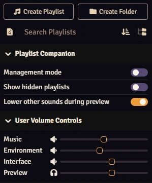
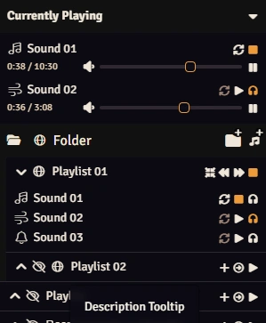
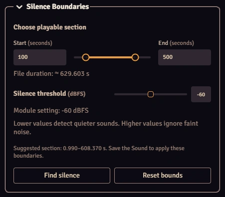

# RN Playlist Companion


[English](#english) | [Русский](#русский)

## Gallery

<p align="center">
  
  
</p>
<p align="center">
  
</p>

## English

Enhance Foundry VTT’s built-in playlists and improve their performance. Preview sounds before playing them, make playlists global across your worlds, control their visibility, and more.

### Manual Installation

In Foundry VTT, open **Add-on Modules → Install Module**, paste the following URL into **Manifest URL**, and click **Install**:

```
https://github.com/RaiNaifa/rn-playlist-companion/releases/latest/download/module.json
```

### Features

#### Global Playlists

- Global playlists and folders can be used across all your worlds.
- Playlists or an entire folder branch can be changed between global and local as needed.
- Global playlist data is stored in `Data/rn-global-playlists/`, outside the module folder. Audio files stay in their original locations.
- The data folder is hidden from players in Foundry’s File Browser by default.
- A player can edit a global playlist with **Owner** access and the **Manage Playlists** and **Upload Files** world permissions. Upload Files is required because global playlist changes are saved as JSON. It does not upload audio and is not additionally required for local playlists.
- Global playlists have a built-in archive for recovering deleted or replaced versions.
- ID conflicts between global and local items can be resolved automatically or by the GM.
- ⚠️ World backups do not include global playlists. To view and restore saved versions of global playlists, open Global Playlist Archive in the module settings.

#### Playlists Visibility

- Playlists and folders can be hidden from the sidebar without being deleted.
- Visibility is set independently in each world, including for global playlists and folders.
- GMs can find hidden items through search or temporarily show them in the sidebar.
- A hidden playlist remains visible while it is playing, so its sounds can still be controlled.

#### Sound Preview

- Sounds can be previewed locally alongside other playback.
- Preview appears in **Currently Playing** with a separate volume control.
- Audio ducking temporarily lowers the volume of Music, Environment, and Interface sounds during preview.
- Audio ducking can be enabled or disabled in the Playlist Companion tab as needed.
- The ducking level is configured separately for each client in the module settings.

#### Sound Boundaries and Silence Search

- A GM can adjust the playable start and end in the Sound configuration sheet.
- **Find silence** detects silence at the beginning and end of Foundry-supported audio formats except MIDI, then fills the boundary fields. The default threshold is -60 dBFS. Lower values detect quieter sounds, while higher values ignore faint noise.
- Analysis loads and decodes the full file every time when requested, which may use substantial memory for long files.
- **Currently Playing** and Preview show time relative to the selected section instead of the full file.
- Changing the file path leaves old boundaries inactive until they are checked or analyzed again.

#### Silence Time

- Unlike Find Silence, which trims silence at the edges of an audio file, enabling **Silence Time** adds pauses between the playback of playlist tracks and between repeats of a looping sound.
- During silence, **Currently Playing** shows a countdown and playback controls.
- Combine it with Random Playback to make your surroundings feel alive: a distant rumble of thunder, an unexpected owl call, or an eerie whisper.

#### Random Playback

- Playlists have a **Random Playback** mode. Each sound is selected at random without repeating the currently playing sound. This mode does not shuffle the order of sounds in the playlist.
- **Previous Sound** works for the last 20 transitions. **Next Sound** always makes a new random selection. The history is cleared when the playlist is fully stopped.

#### Playlists Performance

- Collapsed playlists do not render their sound rows, helping Foundry’s interface stay responsive when the playlist sidebar is open, even with many sounds.
- Expanded playlists share one row budget across the visible area. Sounds outside it stay available through scrolling and search.
- Known issue: Minor stutters may occasionally occur when scrolling through a large number of sounds.

#### Audio Buffering

- The audio streaming threshold can be adjusted manually. By default, Foundry streams audio files longer than 600 seconds (10 minutes).
- Streaming can help sounds start sooner for clients because playback can begin before the full file downloads.
- Lowering the threshold also reduces audio buffer memory use. Raising it keeps more sounds fully loaded in memory.
- Inspired by Nordiii's [Audio duration until stream](https://github.com/Nordiii/audio-duration-until-stream-setting). Included here so playlist audio settings can be managed in one module. Implemented independently.

#### Special Settings

- **Hide sound names from players** shows players only the time and volume for sounds in **Currently Playing**, hiding all other details. A player with at least **Observer** access to a playlist can still see the details of its sounds and the playlist. The setting is disabled by default.
- **Preserve Playback** keeps playback running when **Update Sound** or **Update Playlist** is used without changes or after changing only the name, volume, repeat state, fade duration, silence threshold, description, playback mode, or playlist sorting. Changes to the audio source, audio channel, or properties added by other modules still stop playback. The setting is disabled by default.
- **Disable Revision Checks** speeds up global playlist operations by skipping additional file checks. Enable it only when global playlists are managed from one client and starting their playback has a noticeable delay. If several clients manage them at the same time, their changes may overwrite each other. A technical failure during a multi-file operation may save only part of the changes. The setting is disabled by default.

#### Minor Improvements

- Long sound and playlist names scroll on hover when they do not fit in the sidebar.
- GMs can hover over a playlist or sound name to see its description in a compact tooltip.
- Sound icons reflect their audio channel.

## Русский

Расширяет возможности встроенных плейлистов Foundry VTT и улучшает их производительность. Предпрослушивайте звуки перед воспроизведением, используйте общие плейлисты во всех мирах, управляйте их видимостью, и многое другое.

### Установка вручную

В Foundry VTT откройте **Модули → Установить модуль**, вставьте следующую ссылку в поле **Ссылка манифеста** и нажмите **Установить**:

```
https://github.com/RaiNaifa/rn-playlist-companion/releases/latest/download/module.json
```

### Возможности

#### Глобальные плейлисты

- Глобальные плейлисты и папки доступны во всех ваших мирах.
- Плейлист или целую ветку папок при необходимости можно сделать глобальными или локальными.
- Данные глобальных плейлистов хранятся в `Data/rn-global-playlists/` вне папки модуля. Аудиофайлы остаются в исходных расположениях.
- По умолчанию папка с данными скрыта от игроков в файловом менеджере Foundry.
- Игрок может редактировать глобальный плейлист, если у него есть уровень доступа **Владелец**, а его роли выданы мировые права **Управление плейлистами** и **Загрузка файлов**. Право на загрузку файлов требуется, поскольку изменения глобальных плейлистов сохраняются в JSON. Аудиофайлы при этом не загружаются, а для локальных плейлистов это дополнительное право не требуется.
- Архив глобальных плейлистов в настройках модуля позволяет восстанавливать удалённые или заменённые версии.
- Конфликты ID между глобальными и локальными объектами могут разрешаться автоматически или GMом.
- ⚠️ Резервные копии миров не включают глобальные плейлисты. Для просмотра и восстановления сохранённых версий глобальных плейлистов откройте Архив глобальных плейлистов в настройках модуля.

#### Видимость плейлистов

- Плейлисты и папки можно скрывать с боковой панели, не удаляя их.
- Видимость настраивается отдельно в каждом мире, в том числе для глобальных плейлистов и папок.
- GM может найти скрытые объекты через поиск или временно отобразить их включением опции во вкладке Playlist Companion боковой панели.
- Скрытый плейлист остаётся видимым во время воспроизведения, чтобы его звуками можно было управлять.

#### Предпрослушивание звуков

- Звуки можно предпрослушивать локально одновременно с остальным воспроизведением.
- Предпрослушивание отображается в **Сейчас играет** с отдельной регулировкой громкости.
- Приглушение аудио позволяет временно уменьшать громкость музыки, окружения и интерфейса во время предпрослушивания.
- Приглушение можно включать и отключать во вкладке Playlist Companion по мере надобности.
- Степень приглушения настраивается отдельно для каждого клиента в настройках модуля.

#### Границы звука и Поиск тишины

- GM может настроить начало и конец воспроизводимого участка в окне настройки звука.
- **Поиск тишины** определяет тишину в начале и конце аудиофайлов поддерживаемых Foundry форматов, кроме MIDI, и устанавливает соответствующие значения начала и конца воспроизводимого участка. Порог по умолчанию −60 dBFS. Низкие значения включают более тихие звуки, высокие отсекают слабый шум.
- При каждом запуске анализа файл полностью загружается и декодируется, поэтому длинные файлы могут потреблять много памяти.
- В разделе **Сейчас играет** время отображается относительно выбранного участка, а не всего файла.
- После изменения пути к файлу прежние границы не используются, пока их не проверить или не определить заново.

#### Время тишины

- В отличие от Поиска тишины, который отсекает тишину на границах файла, включение опции **Время тишины** позволяет добавить паузы между проигрыванием треков плейлиста и между повторами зацикленного звука.
- Для времени тишины в **Сейчас играет** отображаются обратный отсчёт и элементы управления.
- Сочетайте с режимом Случайного воспроизведения, чтобы заставить окружение жить своей жизнью: редкий раскат грома вдалеке, неожиданный крик совы или зловещий шёпот.

#### Случайное воспроизведение

- Для плейлистов добавлен режим воспроизведения **Случайный**. В нём каждый включаемый звук выбирается случайно, не повторяя при этом текущий. Порядок звуков в самом плейлисте в этом режиме не перемешивается.
- **Предыдущий звук** работает для последних 20 переходов. **Следующий звук** всегда делает новый случайный выбор. При полной остановке плейлиста история очищается.

#### Производительность плейлистов

- Для свёрнутых плейлистов строки звуков не отрисовываются. Благодаря этому интерфейс Foundry остаётся отзывчивым при открытой боковой панели плейлистов даже с большим количеством звуков.
- Развёрнутые плейлисты используют общий лимит строк в видимой области. Остальные звуки остаются доступны через прокрутку и поиск.
- Известная проблема: при прокрутке большого количества звуков иногда могут возникать небольшие подтормаживания.

#### Буферизация аудио

- Порог потокового воспроизведения аудио можно настроить вручную. По умолчанию Foundry использует потоковое воспроизведение для файлов длиннее 600 секунд (10 минут).
- Потоковое воспроизведение может ускорить запуск звуков у клиентов, поскольку он начинается до полной загрузки файла.
- Уменьшение порога также сокращает потребление памяти аудиобуферами. При увеличении порога больше звуков полностью загружается в память.
- Функция вдохновлена модулем Nordiii [Audio duration until stream](https://github.com/Nordiii/audio-duration-until-stream-setting). Она добавлена сюда, чтобы настройками аудио плейлистов можно было управлять в одном модуле, и реализована независимо.

#### Особые настройки

- **Скрывать имена звуков от игроков** показывает игрокам только время и громкость для звуков в **Сейчас играет**, скрывая остальные детали. Игрок с доступом к плейлисту хотя бы на уровне **Наблюдатель** всё ещё может видеть детали его звуков и самого плейлиста. По умолчанию настройка отключена.
- **Сохранение воспроизведения** не останавливает звук при использовании кнопок **Обновить звук** или **Обновить плейлист**, если ничего не изменилось либо изменились только: название, громкость, повторение, длительность затухания, порог тишины, описание, режим воспроизведения или сортировка плейлиста. Изменение источника аудио, аудиоканала или свойств, добавленных другими модулями, по-прежнему останавливает воспроизведение. По умолчанию настройка отключена.
- **Отключение проверок ревизии** ускоряет операции с глобальными плейлистами, пропуская дополнительные проверки файлов. Включайте эту настройку, только если управление глобальными плейлистами происходит с одного клиента и запуск их воспроизведения происходит с заметной задержкой. Если плейлистами одновременно управляют несколько клиентов, при включённой настройке их изменения могут перезаписать друг друга. При технической ошибке во время операции с несколькими файлами изменения могут сохраниться лишь частично. По умолчанию настройка отключена.

#### Небольшие улучшения

- Длинные названия звуков и плейлистов прокручиваются при наведении, если не помещаются на боковой панели.
- GM может навести указатель на название плейлиста или звука, чтобы увидеть его описание в компактной подсказке.
- Значки звуков отражают их аудиоканал.
